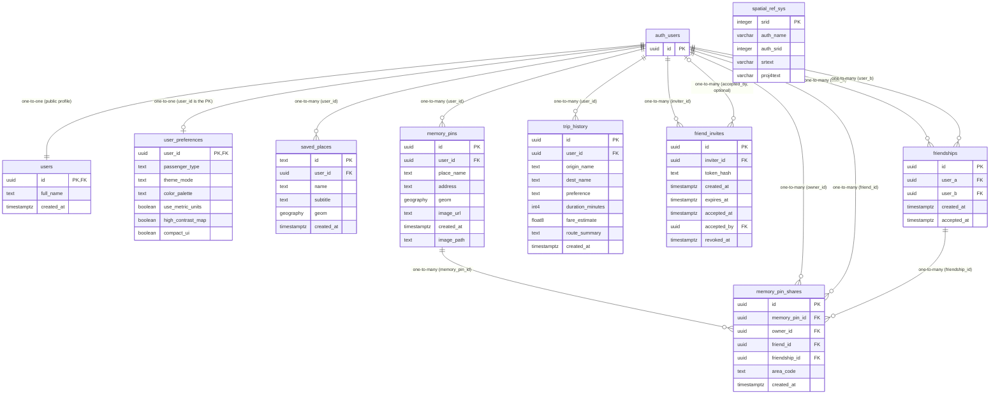

# Mapparaan Supabase ERD

This ERD reflects the schema screenshot supplied for this project. The Mermaid
identifier `auth_users` represents Supabase's `auth.users` table; the
application-owned profile table is `public.users`.

### Relationship cardinalities

- **One-to-one:** `auth.users` ↔ `public.users` via `id`; `auth.users` ↔
  `user_preferences` via `user_id`.
- **One-to-many / many-to-one:** `auth.users` → `saved_places`, `memory_pins`,
  `trip_history`, and `friendships`; the inverse from each child row to its
  owning user is many-to-one. `memory_pins`, `friendships`, and `auth.users`
  each have one-to-many relationships to `memory_pin_shares`; from a share to
  each referenced row, the relationship is many-to-one. `friend_invites` has
  a many-to-one `inviter_id` and an optional many-to-one `accepted_by`.
- **Many-to-many:** `auth.users` ↔ `auth.users` through `friendships`, using
  `user_a` and `user_b`; `memory_pins` ↔ recipient `auth.users` through
  `memory_pin_shares`, using `memory_pin_id` and `friend_id`.

Each share also records `owner_id` and the matching `friendship_id`. The
migrations use `(memory_pin_id, friend_id)` as the conflict key when saving
shares, so that pair is unique even though `memory_pin_shares.id` is the
primary key.

`spatial_ref_sys` is PostGIS reference metadata and has no application
relationship in this ERD. Supabase Storage's `storage.objects` is also omitted;
it is a storage table, not one of the application's relational tables.

For a visual, editable version, open
[`supabase_erd.drawio`](supabase_erd.drawio) in diagrams.net or the Draw.io
extension in VS Code.
